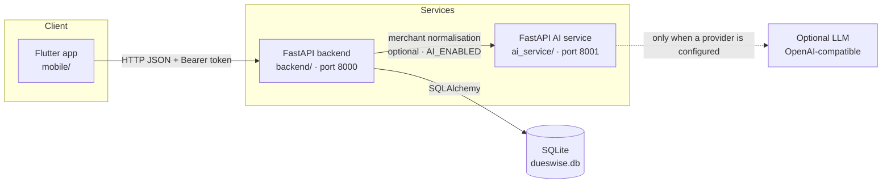

# DuesWise-AI

**Spend smart, stay ahead.** An AI-assisted personal finance assistant for India — built around deterministic money rules, synthetic data, and an optional AI service.

[](#prerequisites)
[](#technology-stack)
[](#prerequisites)
[](#architecture-overview)

> **Hackathon MVP.** No real-money transactions, no trading, no bank credentials. All demo data is synthetic.

---

## Table of contents

1. [Introduction](#introduction)
2. [Problem](#problem)
3. [Our solution](#our-solution)
4. [Key features](#key-features)
5. [How the application works](#how-the-application-works)
6. [Architecture overview](#architecture-overview)
7. [Technology stack](#technology-stack)
8. [Repository structure](#repository-structure)
9. [Prerequisites](#prerequisites)
10. [Installation](#installation)
11. [Running the backend](#running-the-backend)
12. [Running the AI service](#running-the-ai-service)
13. [Running the Flutter app](#running-the-flutter-app)
14. [Environment variables](#environment-variables)
15. [Mock mode vs live mode](#mock-mode-vs-live-mode)
16. [API documentation](#api-documentation)
17. [Testing](#testing)
18. [Troubleshooting](#troubleshooting)
19. [Current limitations](#current-limitations)
20. [Future improvements](#future-improvements)
21. [Contributing](#contributing)
22. [Further documentation](#further-documentation)

---

## Introduction

DuesWise-AI is a mobile-first personal finance assistant for three Indian personas: salaried employees, young professionals, and small shopkeepers. It helps you see what is safe to spend after obligations, what is due next, which subscriptions are quietly renewing, whether a message looks like a scam, and how the old and new tax regimes compare.

Every financial calculation is deterministic and expressed in integer paise. The independent AI service only *words* things (merchant names) and is strictly optional — when it is unavailable, the product still works.

## Problem

Indian salaried individuals and young professionals often struggle to:

- Track recurring subscriptions, EMIs, rent and utilities.
- Work out how much is genuinely safe to spend before the next payday.
- Compare the old vs new income-tax regimes without a spreadsheet.
- Spot phishing and UPI-fraud messages.
- Understand small-business cash flow and receivables.

## Our solution

- A **Flutter app** that always works offline in mock mode and can switch to a live backend.
- A **FastAPI backend** that owns all money rules, persistence, authentication (demo sessions) and business logic.
- An **independent AI microservice** that normalises messy merchant strings, explains a backend-computed risk score, and phrases nudges — with deterministic fallbacks and no financial authority.

## Key features

| Area | What it does |
|---|---|
| Dashboard | Available balance, safe-to-spend, upcoming dues total, safety reserve, next due, recent transactions |
| Transactions | List, search, category filter, detail, manual import, SMS import, CSV/PDF statement import, AA-style mock ingestion |
| Dues | Upcoming/paid/overdue list, due detail, mark as paid, create and update |
| Subscriptions | Detected subscription list, confirm or dismiss detections |
| Nudges | Priority-ordered insights with read/dismiss state |
| Scam detection | Deterministic risk score and indicators, explanation, recommended actions, stored alerts |
| Tax comparison | Old vs new regime comparison from configurable rule data, with disclaimer |
| Business cash flow | Sales, expenses, receivables, payables, projected balance for the shopkeeper persona |
| Investments | Simulated, educational portfolio summary — never real trading |
| Personas | Salaried, young professional, shopkeeper — deterministic synthetic data |
| Offline mode | Full mock repository driven by bundled JSON fixtures |

## How the application works

1. The app starts in **mock mode** (`USE_MOCK_API=true`) and is fully usable without any server.
2. In **live mode**, the app creates a synthetic demo session (`POST /api/v1/auth/demo`) and receives an opaque bearer token (the demo user's UUID).
3. Every screen calls the same `FinanceRepository` interface; `LiveFinanceRepository` maps backend JSON onto the UI models.
4. The backend validates input, applies deterministic rules (safe-to-spend, tax, recurring detection, scam scoring), persists to SQLite, and returns contract-shaped JSON.
5. If `AI_ENABLED=true`, the backend asks the AI service to normalise unknown merchants; on timeout or failure it silently falls back to deterministic categorisation.
6. Errors are returned in one format (`{"error": {"code", "message", "details"}}`) and surfaced in the UI as retryable states.

## Architecture overview



Key rules:

- Flutter **never** calls the AI service directly.
- The AI service has **no database** and never computes money values.
- Scam risk scores and safe-to-spend are always computed by the backend.
- AI failure never breaks a core calculation.

More detail: [docs/ARCHITECTURE.md](docs/ARCHITECTURE.md).

## Technology stack

| Layer | Technology |
|---|---|
| Mobile app | Flutter (Material 3), Dart, GoRouter, Riverpod, http, shared_preferences, intl |
| Backend | Python 3.11+, FastAPI, Pydantic v2, SQLAlchemy 2.x, SQLite, uvicorn |
| AI service | Python 3.11+, FastAPI, Pydantic v2, httpx, uvicorn |
| Documents | pdfplumber (PDF statements), multipart CSV upload |
| Testing | pytest + FastAPI TestClient, flutter_test, dart analyze |
| Data | Synthetic JSON fixtures, deterministic demo personas, integer paise |

## Repository structure

```text
DUESWISE-AI/
├── backend/                    # FastAPI backend (port 8000)
│   ├── app/
│   │   ├── api/routes/         # auth, dashboard, transactions, ingestion, dues,
│   │   │                       # subscriptions, nudges, scams, tax, business,
│   │   │                       # investments, system, health
│   │   ├── models/             # SQLAlchemy models
│   │   ├── repositories/       # user-scoped data access
│   │   ├── schemas/            # Pydantic request/response models
│   │   ├── services/           # safe-to-spend, forecaster, tax, scam, AI client
│   │   ├── rules/              # JSON rule data (categories, tax, merchants)
│   │   ├── main.py             # app factory, error handlers, lifespan
│   │   └── config.py           # environment settings
│   ├── tests/                  # unit + integration tests (pytest)
│   ├── requirements.txt
│   ├── .env.example
│   └── README.md
├── ai_service/                 # Independent AI microservice (port 8001)
│   ├── app/                    # main, config, routes, schemas, services, utils
│   ├── tests/                  # pytest suite (no real LLM calls)
│   ├── requirements.txt
│   ├── requirements-dev.txt
│   ├── .env.example
│   └── README.md
├── mobile/                     # Flutter application
│   ├── lib/
│   │   ├── app/                # MaterialApp, GoRouter routes, repository provider
│   │   ├── config/             # USE_MOCK_API, backend base URL
│   │   ├── core/               # theme, money, errors, shared widgets
│   │   ├── data/               # models, repositories, live + mock implementations
│   │   └── features/           # auth, dashboard, transactions, dues, subscriptions,
│   │                           # insights, scam, tax, business, investments, settings
│   ├── android/ · ios/ · web/  # platform runners (generated, verified web build)
│   ├── assets/mock_data/       # deterministic JSON fixtures
│   ├── test/                   # unit + widget tests and test/integration/
│   └── pubspec.yaml
├── docs/                       # architecture, setup, API integration notes
├── BLUEPRINT.md                # product blueprint and business rules
├── CONTRACTS.md                # API contract (draft + as-built notes)
└── README.md
```

## Prerequisites

| Tool | Version | Notes |
|---|---|---|
| Python | 3.11+ | Backend and AI service |
| pip | Bundled with Python | Dependency installs |
| Flutter SDK | **3.35+** (Dart 3.9+) | Verified with Flutter 3.35.7 / Dart 3.9.2 |
| Android Studio or Xcode | Optional | For emulator/device runs |
| SQLite | Bundled via Python | No separate install needed |

> Flutter 3.24 / Dart 3.5 **cannot** resolve this project: `flutter_localizations` pins `intl 0.20.2`, and the app does not build on older SDKs. Use a current stable Flutter.

## Installation

```bash
git clone https://github.com/varnesh123/DUESWISE-AI.git
cd DUESWISE-AI

# Backend + AI service share a simple venv here; you may also create one per component.
python3 -m venv .venv
source .venv/bin/activate          # Windows: .venv\Scripts\activate
pip install -r backend/requirements.txt
pip install -r ai_service/requirements-dev.txt

# Flutter
cd mobile
flutter pub get
cd ..
```

## Running the backend

```bash
cd backend
source ../.venv/bin/activate       # if you used the shared venv
cp .env.example .env               # optional — defaults already work
uvicorn app.main:app --reload --port 8000
```

- Health: <http://localhost:8000/health> → `{"status":"ok"}`
- OpenAPI UI: <http://localhost:8000/docs>
- SQLite database is created automatically at `backend/dueswise.db`.

## Running the AI service

```bash
cd ai_service
source ../.venv/bin/activate
cp .env.example .env               # optional — deterministic mode by default
uvicorn app.main:app --reload --port 8001
```

- Health: <http://localhost:8001/health> → `{"status":"ok"}`
- Docs: <http://localhost:8001/docs>

To let the backend use it, set `AI_ENABLED=true` in `backend/.env`:

```env
AI_ENABLED=true
AI_SERVICE_BASE_URL=http://localhost:8001
```

With `AI_PROVIDER=none` (the default), the AI service still normalises merchants from its curated dictionary — no API key required.

## Running the Flutter app

**Mock mode (default — no servers needed):**

```bash
cd mobile
flutter pub get
flutter run              # device/emulator
flutter run -d chrome    # browser
```

**Live mode (backend required):**

```bash
cd mobile
flutter run \
  --dart-define=USE_MOCK_API=false \
  --dart-define=BACKEND_BASE_URL=http://10.0.2.2:8000
```

| Target | `BACKEND_BASE_URL` |
|---|---|
| Android emulator | `http://10.0.2.2:8000` |
| iOS simulator / desktop | `http://localhost:8000` |
| Physical device | `http://<your-LAN-IP>:8000` |

## Environment variables

### Backend (`backend/.env`)

| Variable | Default | Purpose |
|---|---|---|
| `DATABASE_URL` | `sqlite:///./dueswise.db` | SQLAlchemy database URL |
| `APP_ENV` | `development` | Environment label |
| `DEBUG` | `true` | FastAPI debug mode |
| `APP_NAME` / `APP_VERSION` | `DuesWise` / `1.0.0` | Metadata |
| `AI_ENABLED` | `false` | Enables backend → AI service calls |
| `AI_SERVICE_BASE_URL` | `http://localhost:8001` | AI service origin |
| `AI_TIMEOUT_SECONDS` | `5` | Per-call timeout |
| `AI_MAX_RETRIES` | `1` | Retry count |
| `DEFAULT_CURRENCY` | `INR` | Currency label |
| `TIMEZONE` | `Asia/Kolkata` | Business-day timezone |
| `FORECAST_HORIZON_DAYS` | `30` | Safe-to-spend horizon |
| `SAFETY_RESERVE_PERCENT` | `10` | Reserve percentage |
| `MAX_NUDGES_PER_7_DAYS` | `3` | Nudge throttle |
| `LOG_LEVEL` | `INFO` | Logging level |
| `MAX_FILE_SIZE_MB` | `10` | Statement upload limit |

### AI service (`ai_service/.env`)

| Variable | Default | Purpose |
|---|---|---|
| `AI_PROVIDER` | `none` | `none`, `openai_compatible`, `openai`, `groq` |
| `AI_API_KEY` | empty | Provider key — never commit |
| `AI_MODEL` | empty | Model identifier |
| `AI_BASE_URL` | empty | OpenAI-compatible base URL |
| `AI_TIMEOUT_SECONDS` | `5` | Provider timeout |
| `AI_MAX_RETRIES` | `1` | Provider retries |
| `HOST` / `PORT` | `0.0.0.0` / `8001` | Bind address |
| `CORS_ALLOW_ORIGINS` | empty | Comma-separated allowed origins |

`LLM_*` names are accepted as aliases for the `AI_*` provider variables.

### Flutter

| Flag | Default | Purpose |
|---|---|---|
| `USE_MOCK_API` | `true` | `true` = bundled fixtures, `false` = live backend |
| `BACKEND_BASE_URL` | `http://localhost:8000` | Backend origin for live mode |

No secrets belong in the Flutter app.

## Mock mode vs live mode

| | Mock mode (default) | Live mode |
|---|---|---|
| Servers required | None | Backend (and optionally AI service) |
| Data source | `mobile/assets/mock_data/*.json` | SQLite via FastAPI |
| Auth | Simulated | Synthetic demo session, bearer token |
| Persistence | In-memory for the session | SQLite |
| Use it for | Demos, UI work, offline judging | End-to-end verification |

Switch with `--dart-define=USE_MOCK_API=false`.

## API documentation

- Interactive OpenAPI: <http://localhost:8000/docs> (backend) and <http://localhost:8001/docs> (AI service).
- Machine-readable: <http://localhost:8000/openapi.json>.
- Endpoint-by-endpoint mapping between the app and backend: [docs/API_INTEGRATION.md](docs/API_INTEGRATION.md).
- Original contract: [CONTRACTS.md](CONTRACTS.md).

Highlights:

```text
POST /api/v1/auth/demo               Create a synthetic demo session
GET  /api/v1/dashboard/summary       Safe-to-spend dashboard
GET  /api/v1/transactions            List + filter transactions
POST /api/v1/transactions/ingest     Manual entry or SMS text
POST /api/v1/transactions/ingest/file  CSV/PDF statement upload
GET  /api/v1/dues/{due_id}           Due detail
POST /api/v1/dues/{due_id}/mark-paid Mark a due paid
GET  /api/v1/subscriptions           Detected subscriptions
GET  /api/v1/nudges                  Insights
POST /api/v1/scams/analyze           Deterministic scam analysis
POST /api/v1/tax/compare             Old vs new regime
GET  /api/v1/business/cashflow       Small-business cash flow
GET  /api/v1/investments/summary     Simulated portfolio summary
```

## Testing

All commands were run in this repository; results below are actual.

```bash
# Backend — 175 tests
cd backend
pytest -q

# AI service — 81 tests
cd ai_service
pytest -q

# Flutter — 45 offline tests, 0 analyzer errors
cd mobile
flutter pub get
dart analyze
flutter test

# Flutter ⇄ backend live integration — 9 tests (real HTTP, no mocks)
# Start the backend (port 8099) and AI service first, then:
cd mobile
flutter test test/integration/live_backend_test.dart \
  --dart-define=LIVE_BACKEND=http://127.0.0.1:8099 \
  --dart-define=EXPECT_AI=true
```

| Suite | Tests | Status |
|---|---|---|
| Backend (unit + API) | 175 | ✅ passing |
| AI service | 81 | ✅ passing |
| Flutter (unit/widget) | 45 | ✅ passing |
| Flutter ⇄ backend (live HTTP) | 9 | ✅ passing |
| Dart analyzer | — | ✅ 0 errors |

The live suite is skipped automatically when `LIVE_BACKEND` is not provided, so the offline suite stays green.

## Troubleshooting

| Symptom | Cause / fix |
|---|---|
| `version solving failed` mentioning `intl` | Flutter SDK too old. Use Flutter 3.35+ (Dart 3.9+). |
| `Address already in use` | Another process holds port 8000/8001. Stop it or use `--port`. |
| App shows “Something went wrong … UNAUTHORIZED” | Live mode without a session. Go back and log in again (demo login). |
| Android emulator cannot reach the backend | Use `10.0.2.2`, not `localhost`. |
| `merchant_normalize` not called | `AI_ENABLED=false` in `backend/.env`, or the AI service is down — deterministic fallback is used. |
| Scam/tax endpoints return `422` | Check the request shape in `/docs`; tax accepts only rule-backed financial years. |
| PDF parsing fails | Text-based PDFs only; scanned images are unsupported. |

## Current limitations

- **Authentication is a demo session**, not production auth: no passwords, no registration, no token expiry enforcement. The token is the demo user's UUID. Do not treat it as real security.
- **Single-tenant demo data.** No multi-device sync, no password reset, no roles.
- **AI scam explanations and nudge wording endpoints exist but are not wired into backend flows**; the backend uses its own deterministic text. Only merchant normalisation is called by the backend.
- Scam risk scores, safe-to-spend and tax numbers are **deterministic heuristics**, not financial or legal advice.
- Tax rules are marked `unverified` in `backend/app/rules/tax_rules.json` and support a single financial year (`FY-2025-26`).
- Investments are **simulated**; there is no trading, brokerage or market data.
- SQLite is fine for a demo but not for concurrent production use; no migrations framework yet.
- The Flutter app has no CI/device farm; UI is verified by tests and manual runs only.

## Future improvements

- Real authentication (hashed credentials, refresh tokens, expiry) with per-user data isolation.
- Alembic migrations and a production database.
- Wire the AI explanation/nudge endpoints into the backend with strict output validation.
- Add tax rules for multiple financial years with a signed-off rule version.
- Push notifications for nudges and due reminders.
- Widget tests per screen and golden tests for critical flows.
- Accessibility pass (labels, contrast, text scaling).

## Contributing

1. Fork the repository and create a branch: `git checkout -b feature/your-feature`.
2. Keep the existing architecture: rules in backend services, UI behind `FinanceRepository`.
3. Money is integer paise — never floats.
4. Run the suites you touch: `pytest -q` (backend), `pytest -q` (AI service), `dart analyze` + `flutter test` (mobile).
5. Do not commit `.env`, databases, `build/`, or generated dependency folders.
6. Open a pull request describing the change and the commands you ran.

## Further documentation

- [docs/ARCHITECTURE.md](docs/ARCHITECTURE.md) — layers, data flow, design decisions.
- [docs/SETUP.md](docs/SETUP.md) — beginner-friendly setup and verification.
- [docs/API_INTEGRATION.md](docs/API_INTEGRATION.md) — app ⇄ backend endpoint matrix and as-built contract notes.
- [backend/README.md](backend/README.md) — backend endpoints and configuration.
- [mobile/README.md](mobile/README.md) — app structure, mock/live modes, tests.
- [ai_service/README.md](ai_service/README.md) — AI endpoints, privacy rules, provider setup.
- [BLUEPRINT.md](BLUEPRINT.md) and [CONTRACTS.md](CONTRACTS.md) — original product and API design.

---

*DuesWise-AI — Spend smart, stay ahead.*
