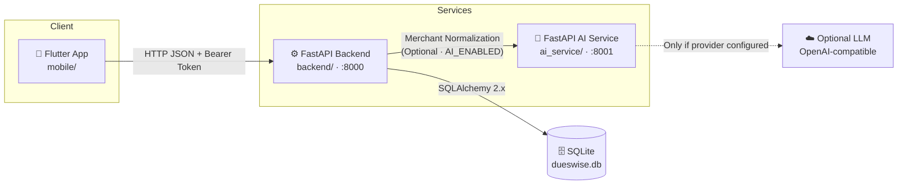

```markdown
<div align="center">

# 💸 DuesWise-AI

**Spend smart, stay ahead.**  
*An AI-assisted personal finance copilot for India — built around deterministic money rules, synthetic demo personas, and an optional AI microservice.*

[](#prerequisites)
[](#technology-stack)
[](#prerequisites)
[](#architecture-overview)
[](#testing)

> **Hackathon MVP** · No real-money transactions · No trading · No bank credentials · 100% synthetic data

[Quick Start](#-installation) • [Architecture](#-architecture-overview) • [API Reference](#-api-documentation) • [Test Suite](#-testing) • [Docs](#-further-documentation)

</div>

---

## 🧭 Table of Contents

<details>
<summary><b>Click to expand navigation</b></summary>

1. [Introduction](#-introduction)
2. [Problem & Solution](#-problem--solution)
3. [Key Features](#-key-features)
4. [How It Works](#-how-it-works)
5. [Architecture Overview](#-architecture-overview)
6. [Technology Stack](#-technology-stack)
7. [Repository Structure](#-repository-structure)
8. [Prerequisites](#-prerequisites)
9. [Installation](#-installation)
10. [Running the Services](#-running-the-services)
11. [Environment Variables](#-environment-variables)
12. [Mock Mode vs Live Mode](#-mock-mode-vs-live-mode)
13. [API Documentation](#-api-documentation)
14. [Testing](#-testing)
15. [Troubleshooting](#-troubleshooting)
16. [Current Limitations & Roadmap](#-current-limitations--roadmap)
17. [Contributing & Further Documentation](#-contributing--further-documentation)

</details>

---

## 🚀 Introduction

**DuesWise-AI** is a mobile-first personal finance assistant tailored for three Indian financial personas: **salaried employees**, **young professionals**, and **small shopkeepers**. It calculates what is genuinely safe to spend after upcoming obligations, flags recurring subscriptions, analyzes suspicious SMS/UPI messages for scam indicators, and compares India's Old vs. New income tax regimes.

Every financial calculation is **100% deterministic** and computed in **integer paise** (never floating-point). The standalone AI microservice only *phrases* text (merchant normalization) and is strictly optional—if unavailable, the core app continues working seamlessly.

---

## 🎯 Problem & Solution

### The Problem
Indian salaried individuals, young professionals, and small merchants frequently struggle to:
- Track fragmented recurring subscriptions, EMIs, rent, and utility bills.
- Know how much balance is truly **safe to spend** before the next payday.
- Compare the **Old vs. New income-tax regimes** without manual spreadsheets.
- Spot phishing and **UPI-fraud messages** before clicking malicious links.
- Track small-business cash flow, receivables, and payables.

### Our Solution
- 📱 **Flutter Mobile & Web App:** Works offline out-of-the-box in mock mode and switches cleanly to a live backend.
- ⚙️ **FastAPI Core Backend:** Owns all deterministic money rules, persistence, demo sessions, and business logic.
- 🧠 **Decoupled AI Microservice:** Normalizes messy merchant strings with deterministic dictionary/heuristic fallbacks and zero financial authority.

---

## ✨ Key Features

| Module | Capabilities |
| :--- | :--- |
| 📊 **Dashboard** | Available balance, **safe-to-spend**, upcoming dues total, safety reserve, next due, and recent transactions |
| 💳 **Transactions** | Search, category filters, manual entry, SMS parsing, CSV/PDF statement upload, and AA-style mock ingestion |
| 📅 **Dues Tracker** | Upcoming, paid, and overdue bills with one-tap mark-as-paid, creation, and updates |
| 🔄 **Subscriptions** | Automated recurring payment detection with user confirmation or dismissal |
| 💡 **Smart Nudges** | Priority-ordered financial insights with read/dismiss state tracking |
| 🛡️ **Scam Detection** | Deterministic risk score, red-flag indicators, recommended actions, and stored alerts |
| 🧾 **Tax Comparison** | Old vs. New regime breakdown driven by configurable rule files (`FY-2025-26`) |
| 🏪 **Business Cash Flow** | Sales, expenses, receivables, payables, and projected balance for the shopkeeper persona |
| 📈 **Investments** | Simulated, educational portfolio summary (strictly non-transactional) |
| 👤 **Demo Personas** | Instant switching across *Salaried*, *Young Professional*, and *Shopkeeper* synthetic profiles |
| 📴 **Offline Mock Mode** | Complete mock repository powered by bundled JSON fixtures |

---

## ⚙️ How It Works

1. **Zero-Config Startup:** The app launches in **mock mode** (`USE_MOCK_API=true`) and is immediately usable without running any servers.
2. **Demo Authentication:** In **live mode**, the client requests a synthetic demo session (`POST /api/v1/auth/demo`) and receives an opaque bearer token.
3. **Clean Repository Abstraction:** Every screen talks to `FinanceRepository`; `LiveFinanceRepository` maps backend payloads to UI models.
4. **Deterministic Backend Engine:** FastAPI validates inputs, runs integer-paise financial rules (safe-to-spend, tax, recurring detection, scam scoring), and persists to SQLite.
5. **Graceful AI Fallback:** When `AI_ENABLED=true`, the backend queries `ai_service` to normalize unknown merchants—falling back silently to local rules on timeout or failure.
6. **Uniform Error Handling:** Errors follow a single contract (`{"error": {"code", "message", "details"}}`) surfaced as retryable UI states.

---

## 🏗️ Architecture Overview



> **Architectural Guardrails:**
> * Flutter **never** communicates directly with the AI service.
> * The AI service has **no database** and **never** computes financial numbers.
> * Safe-to-spend and scam risk scores are always computed deterministically by the backend.
> 
> 

---

## 🛠️ Technology Stack

| Layer | Technologies |
| --- | --- |
| **Mobile & Web UI** | Flutter (Material 3), Dart, GoRouter, Riverpod, `http`, `shared_preferences`, `intl` |
| **Core Backend** | Python 3.11+, FastAPI, Pydantic v2, SQLAlchemy 2.x, SQLite, Uvicorn |
| **AI Microservice** | Python 3.11+, FastAPI, Pydantic v2, HTTPX, Uvicorn |
| **Document Parsing** | `pdfplumber` (text-based PDF statements), multipart CSV upload |
| **Testing & QA** | `pytest`, FastAPI `TestClient`, `flutter_test`, `dart analyze` |
| **Data & Money** | Integer paise arithmetic, deterministic synthetic personas, JSON rule engines |

---

## 📂 Repository Structure

```text
DUESWISE-AI/
├── backend/                    # Core FastAPI backend (port 8000)
│   ├── app/
│   │   ├── api/routes/         # auth, dashboard, transactions, ingestion, dues,
│   │   │                       # subscriptions, nudges, scams, tax, business,
│   │   │                       # investments, system, health
│   │   ├── models/             # SQLAlchemy ORM models
│   │   ├── repositories/       # User-scoped data access layer
│   │   ├── schemas/            # Pydantic request/response contracts
│   │   ├── services/           # Safe-to-spend, forecaster, tax, scam, AI client
│   │   ├── rules/              # JSON rule sets (categories, tax, merchants)
│   │   ├── main.py             # App factory, exception handlers, lifespan
│   │   └── config.py           # Environment configuration
│   ├── tests/                  # 175 unit & integration tests
│   └── requirements.txt
│
├── ai_service/                 # Decoupled AI microservice (port 8001)
│   ├── app/                    # main, config, routes, schemas, services, utils
│   ├── tests/                  # 81 unit tests (no live LLM calls)
│   └── requirements-dev.txt
│
├── mobile/                     # Flutter client (Android, iOS, Web)
│   ├── lib/
│   │   ├── app/                # MaterialApp, GoRouter, repository providers
│   │   ├── config/             # USE_MOCK_API & BACKEND_BASE_URL flags
│   │   ├── core/               # Theme, paise formatter, error models, widgets
│   │   ├── data/               # Models, mock & live repository implementations
│   │   └── features/           # auth, dashboard, transactions, dues, subscriptions,
│   │                           # insights, scam, tax, business, investments, settings
│   ├── assets/mock_data/       # Deterministic offline JSON fixtures
│   └── test/                   # 45 offline tests + 9 live HTTP integration tests
│
├── docs/                       # Architecture, setup, and API integration guides
├── BLUEPRINT.md                # Product blueprint & deterministic business rules
├── CONTRACTS.md                # API contract & as-built notes
└── README.md

```

---

## 📋 Prerequisites

| Tool | Minimum Version | Notes |
| --- | --- | --- |
| **Python** | `3.11+` | Required for `backend/` and `ai_service/` |
| **Flutter SDK** | `3.35+` (Dart `3.9+`) | Verified on Flutter `3.35.7` / Dart `3.9.2` |
| **SQLite** | Bundled | Included with Python standard library |
| **Emulator / Chrome** | Optional | For running Flutter mobile or web targets |

> ⚠️ **SDK Note:** Flutter `3.24` / Dart `3.5` cannot resolve dependencies because `flutter_localizations` pins `intl 0.20.2`. Use Flutter `3.35+`.

---

## 💻 Installation

```bash
git clone [https://github.com/varnesh123/DUESWISE-AI.git](https://github.com/varnesh123/DUESWISE-AI.git)
cd DUESWISE-AI

# 1. Create and activate Python virtual environment
python3 -m venv .venv
source .venv/bin/activate          # Windows PowerShell: .venv\Scripts\Activate.ps1

# 2. Install Backend & AI Service dependencies
pip install -r backend/requirements.txt
pip install -r ai_service/requirements-dev.txt

# 3. Install Flutter dependencies
cd mobile && flutter pub get && cd ..

```

---

## ▶️ Running the Services

### 1. Start the Core Backend (Port `8000`)

```bash
cd backend
cp .env.example .env               # Optional: defaults work out of the box
uvicorn app.main:app --reload --port 8000

```

* **Health Check:** `http://localhost:8000/health` → `{"status":"ok"}`
* **Swagger UI:** `http://localhost:8000/docs`

### 2. Start the AI Microservice (Port `8001`)

```bash
cd ai_service
cp .env.example .env               # Optional: runs deterministically by default
uvicorn app.main:app --reload --port 8001

```

* **Health Check:** `http://localhost:8001/health` → `{"status":"ok"}`
* **Swagger UI:** `http://localhost:8001/docs`

To connect the backend to the AI service, enable it in `backend/.env`:

```env
AI_ENABLED=true
AI_SERVICE_BASE_URL=http://localhost:8001

```

*(With `AI_PROVIDER=none`, the AI service normalizes merchants using its curated dictionary—no API key needed.)*

### 3. Run the Flutter App

**Offline Mock Mode (Default — no backend needed):**

```bash
cd mobile
flutter run              # Connected device or emulator
flutter run -d chrome    # Web browser

```

**Live Mode (Connects to FastAPI backend):**

```bash
cd mobile
flutter run \
  --dart-define=USE_MOCK_API=false \
  --dart-define=BACKEND_BASE_URL=[http://10.0.2.2:8000](http://10.0.2.2:8000)

```

| Target Platform | `BACKEND_BASE_URL` |
| --- | --- |
| **Android Emulator** | `http://10.0.2.2:8000` |
| **iOS Simulator / Desktop / Web** | `http://localhost:8000` |
| **Physical Device (LAN)** | `http://<YOUR-LOCAL-IP>:8000` |

---

## 🔧 Environment Variables

| Variable | Default | Description |
| --- | --- | --- |
| `DATABASE_URL` | `sqlite:///./dueswise.db` | SQLAlchemy connection string |
| `APP_ENV` / `DEBUG` | `development` / `true` | Runtime environment & debug flag |
| `AI_ENABLED` | `false` | Toggle backend → AI service calls |
| `AI_SERVICE_BASE_URL` | `http://localhost:8001` | AI microservice base URL |
| `AI_TIMEOUT_SECONDS` | `5` | Timeout per AI request |
| `AI_MAX_RETRIES` | `1` | Retry attempts on transient failure |
| `DEFAULT_CURRENCY` | `INR` | Currency code |
| `TIMEZONE` | `Asia/Kolkata` | Business-day timezone |
| `FORECAST_HORIZON_DAYS` | `30` | Lookahead window for safe-to-spend |
| `SAFETY_RESERVE_PERCENT` | `10` | Buffer reserve percentage |
| `MAX_NUDGES_PER_7_DAYS` | `3` | Nudge frequency cap |
| `MAX_FILE_SIZE_MB` | `10` | Max CSV/PDF upload size |

| Variable | Default | Description |
| --- | --- | --- |
| `AI_PROVIDER` | `none` | `none`, `openai_compatible`, `openai`, or `groq` |
| `AI_API_KEY` | *(empty)* | Provider API key (never commit) |
| `AI_MODEL` | *(empty)* | Model identifier |
| `AI_BASE_URL` | *(empty)* | Custom OpenAI-compatible endpoint |
| `AI_TIMEOUT_SECONDS` | `5` | Provider timeout |
| `HOST` / `PORT` | `0.0.0.0` / `8001` | Server bind address |

*(Note: `LLM_*` variable names are also accepted as aliases.)*

| Flag | Default | Description |
| --- | --- | --- |
| `USE_MOCK_API` | `true` | `true` uses bundled JSON fixtures; `false` calls live backend |
| `BACKEND_BASE_URL` | `http://localhost:8000` | Backend API origin |

---

## 🔄 Mock Mode vs Live Mode

| Aspect | Mock Mode (`USE_MOCK_API=true`) | Live Mode (`USE_MOCK_API=false`) |
| --- | --- | --- |
| **Servers Required** | None | Backend (and optionally AI Service) |
| **Data Source** | `mobile/assets/mock_data/*.json` | SQLite via FastAPI REST API |
| **Authentication** | Simulated locally | Synthetic demo session + Bearer token |
| **Persistence** | In-memory session only | Persisted in `backend/dueswise.db` |
| **Best For** | Offline demos, UI work, quick previews | End-to-end verification & live testing |

---

## 📡 API Documentation

Interactive OpenAPI docs are available automatically when the services are running:

* **Backend Swagger:** `http://localhost:8000/docs` (`openapi.json` at `/openapi.json`)
* **AI Service Swagger:** `http://localhost:8001/docs`

### Core Endpoints

```http
POST   /api/v1/auth/demo                    # Create a synthetic demo session
GET    /api/v1/dashboard/summary            # Safe-to-spend & financial summary
GET    /api/v1/transactions                 # List & filter transactions
POST   /api/v1/transactions/ingest          # Manual entry or SMS text ingestion
POST   /api/v1/transactions/ingest/file     # CSV / PDF bank statement upload
GET    /api/v1/dues/{due_id}                # Inspect a specific due
POST   /api/v1/dues/{due_id}/mark-paid      # Mark a due as paid
GET    /api/v1/subscriptions                # List detected recurring subscriptions
GET    /api/v1/nudges                       # Fetch prioritized financial insights
POST   /api/v1/scams/analyze                # Deterministic SMS/UPI scam analysis
POST   /api/v1/tax/compare                  # Old vs. New Indian tax regime comparison
GET    /api/v1/business/cashflow            # Small-business cash flow overview
GET    /api/v1/investments/summary          # Simulated portfolio summary

```

---

## 🧪 Testing

All test suites are verified and passing across the stack:

| Test Suite | Command | Tests | Status |
| --- | --- | --- | --- |
| **Backend (Unit + API)** | `cd backend && pytest -q` | **175** | ✅ Passing |
| **AI Microservice** | `cd ai_service && pytest -q` | **81** | ✅ Passing |
| **Flutter (Unit + Widget)** | `cd mobile && flutter test` | **45** | ✅ Passing |
| **Flutter ⇄ Backend Live E2E** | See command below | **9** | ✅ Passing |
| **Dart Static Analysis** | `cd mobile && dart analyze` | — | ✅ 0 Errors |

### Running the Live HTTP Integration Suite

Start the backend on port `8099` and the AI service on port `8001`, then run:

```bash
cd mobile
flutter test test/integration/live_backend_test.dart \
  --dart-define=LIVE_BACKEND=[http://127.0.0.1:8099](http://127.0.0.1:8099) \
  --dart-define=EXPECT_AI=true

```

*(Automatically skipped during standard `flutter test` runs when `LIVE_BACKEND` is unset.)*

---

## 🛠️ Troubleshooting

| Issue | Resolution |
| --- | --- |
| `version solving failed` on `intl` | Upgrade Flutter SDK to `3.35+` (Dart `3.9+`). |
| `Address already in use` | Another process is occupying port `8000` or `8001`; stop it or pass `--port`. |
| `UNAUTHORIZED` error in live mode | Session expired or backend restarted; return to login and start a new demo session. |
| Android emulator can't reach backend | Use `http://10.0.2.2:8000` instead of `localhost`. |
| `merchant_normalize` isn't called | Ensure `AI_ENABLED=true` in `backend/.env` and `ai_service` is running on port `8001`. |
| PDF upload fails | Only text-based PDFs are supported; scanned image PDFs are not parsed. |

---

## 📌 Current Limitations & Roadmap

### Current Limitations

* **Demo Authentication Only:** Uses synthetic user UUID tokens without passwords, registration, or token expiry enforcement.
* **Heuristic Calculations:** Safe-to-spend, scam scoring, and `FY-2025-26` tax rules (`unverified`) are deterministic educational models, not certified financial/legal advice.
* **Simulated Investments:** Portfolio data is mock/educational—no live market feeds or brokerage integrations.
* **AI Scope:** Only merchant normalization is wired into the backend flow; AI scam explanations and nudge phrasing endpoints remain decoupled.

### Future Improvements

* Production JWT/OAuth2 authentication with hashed credentials and refresh tokens.
* PostgreSQL + Alembic database migrations for multi-tenant production deployment.
* Full integration of AI nudge phrasing and scam explanation endpoints with strict output validation.
* Multi-year verified Indian tax rule tables and scheduled push notifications.

---

## 🤝 Contributing & Further Documentation

### Contributing

1. Fork the repo and branch off `main`: `git checkout -b feature/your-feature`
2. Keep business logic in backend services and UI behind `FinanceRepository`.
3. Represent all monetary amounts as **integer paise**—never floats.
4. Ensure `pytest -q`, `dart analyze`, and `flutter test` pass before opening a PR.

### Further Documentation

* 📐 [docs/ARCHITECTURE.md](https://www.google.com/search?q=docs/ARCHITECTURE.md) — System layers, data flow, and design decisions
* 🛠️ [docs/SETUP.md](https://www.google.com/search?q=docs/SETUP.md) — Step-by-step local environment setup
* 🔌 [docs/API_INTEGRATION.md](https://www.google.com/search?q=docs/API_INTEGRATION.md) — Flutter ⇄ Backend endpoint mapping
* 📦 [backend/README.md](https://www.google.com/search?q=backend/README.md) · [mobile/README.md](https://www.google.com/search?q=mobile/README.md) · [ai_service/README.md](https://www.google.com/search?q=ai_service/README.md) — Component-level guides
* 📋 [BLUEPRINT.md](BLUEPRINT.md) & [CONTRACTS.md](CONTRACTS.md) — Product blueprint and API contracts

---

**DuesWise-AI** — *Spend smart, stay ahead.*