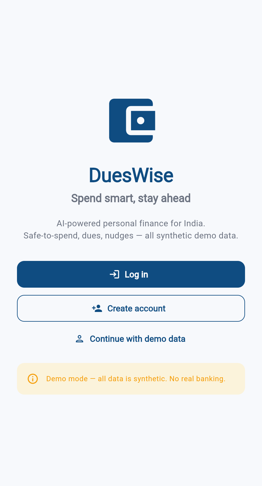
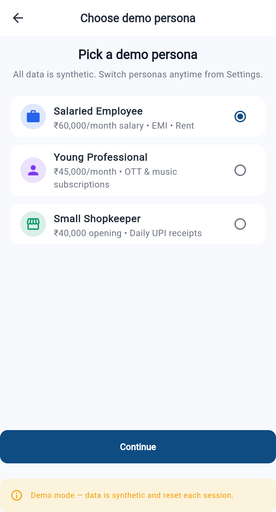
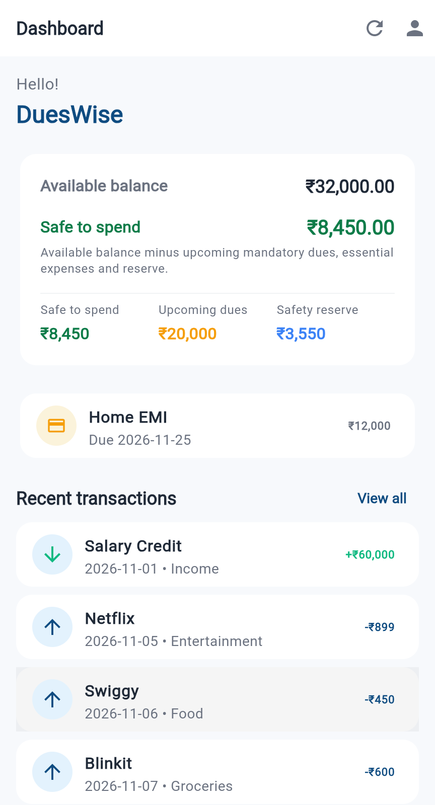
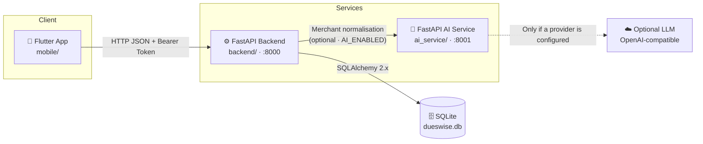

<div align="center">

# 💸 DuesWise-AI

**Spend smart, stay ahead.**

An AI-assisted personal finance copilot for India — real email/password accounts, persistent user-owned records, deterministic money rules, optional synthetic demo personas, and an optional AI microservice.

[](#prerequisites)
[](#technology-stack)
[](#prerequisites)
[](#architecture)
[](#testing)

> **Hackathon MVP** · No real-money transactions · No trading · No bank credentials · Real accounts store only the records you enter · Demo personas are separate and clearly labelled

[Quick Start](#-installation) • [Architecture](#-architecture) • [API Reference](#-api-documentation) • [Testing](#-testing) • [Docs](#-further-documentation)

</div>

---

## 📸 Screenshots

<p align="center">
  
  
  
</p>

---

## 🧭 Table of Contents

<details>
<summary><b>Click to expand navigation</b></summary>

1. [Introduction](#-introduction)
2. [Problem & Solution](#-problem--solution)
3. [Key Features](#-key-features)
4. [How It Works](#-how-it-works)
5. [Architecture](#-architecture)
6. [Technology Stack](#-technology-stack)
7. [Repository Structure](#-repository-structure)
8. [Prerequisites](#-prerequisites)
9. [Installation](#-installation)
10. [Environment Configuration](#-environment-configuration)
11. [Running the Services](#-running-the-services)
12. [Mock Mode vs Live Mode](#-mock-mode-vs-live-mode)
13. [API Documentation](#-api-documentation)
14. [Testing](#-testing)
15. [Troubleshooting](#-troubleshooting)
16. [Security](#-security)
17. [Limitations](#-limitations)
18. [Roadmap](#-roadmap)
19. [Contributing](#-contributing)
20. [License](#-license)
21. [Acknowledgements](#-acknowledgements)

</details>

---

## 🚀 Introduction

**DuesWise-AI** is a mobile-first personal finance assistant. You can create a real account (email + password) and keep your own dues, transactions, and dashboard across sessions, or explore three Indian demo personas: **salaried employees**, **young professionals**, and **small shopkeepers**. It calculates what is genuinely safe to spend after upcoming obligations, tracks recurring subscriptions, analyses suspicious SMS/UPI messages for scam indicators, and compares India's Old vs. New income-tax regimes.

Every financial calculation is **deterministic** and computed in **integer paise** (never floating-point). The standalone AI microservice only *phrases* text and normalises merchant names; it is optional. If it is unavailable, the core application keeps working.

---

## 🎯 Problem & Solution

### The problem

Indian salaried individuals, young professionals, and small merchants frequently struggle to:

- Track fragmented recurring subscriptions, EMIs, rent, and utility bills.
- Know how much balance is truly **safe to spend** before the next payday.
- Compare the **Old vs. New income-tax regimes** without manual spreadsheets.
- Spot phishing and **UPI-fraud messages** before clicking malicious links.
- Track small-business cash flow, receivables, and payables.

### Our solution

- 🔐 **Real accounts** — PBKDF2-hashed passwords, opaque server-side sessions, logout revocation, and backend-enforced ownership isolation.
- 📱 **Flutter mobile & web app** — works offline in mock mode and switches cleanly to a live backend; live accounts persist their records.
- ⚙️ **FastAPI core backend** — owns all deterministic money rules, persistence, authentication, and business logic.
- 🧠 **Decoupled AI microservice** — normalises messy merchant strings with deterministic dictionary/heuristic fallbacks and has zero financial authority.

---

## ✨ Key Features

All features below are implemented in this repository.

| Module | Capabilities |
| :--- | :--- |
| 🔐 **Real Accounts** | Email/password registration and login, PBKDF2 password hashing, hashed session tokens, logout revocation, and per-account data isolation |
| 📊 **Dashboard** | Real empty states, available balance, **safe-to-spend**, upcoming dues total, safety reserve, next due, and recent transactions |
| 💳 **Transactions** | Create, edit, delete, search, filter, sort, manual entry, SMS parsing, CSV/PDF statement upload, and AA-style mock ingestion |
| 📅 **Dues Tracker** | Create, edit, delete, search/filter/sort, upcoming/paid/overdue states, and one-tap mark-as-paid |
| 🔄 **Subscriptions** | Detection of recurring payments with user confirmation or dismissal |
| 💡 **Smart Nudges** | Priority-ordered financial insights with read/dismiss state tracking |
| 🛡️ **Scam Detection** | Deterministic risk score, red-flag indicators, recommended actions, and stored alerts |
| 🧾 **Tax Comparison** | Old vs. New regime breakdown driven by configurable rule files (`FY-2025-26`) |
| 🏪 **Business Cash Flow** | Sales, expenses, receivables, payables, and projected balance for the shopkeeper persona |
| 📈 **Investments** | Simulated, educational portfolio summary (strictly non-transactional) |
| 👤 **Demo Personas** | Instant switching across *Salaried*, *Young Professional*, and *Shopkeeper* synthetic profiles |
| 📴 **Offline Mock Mode** | Complete mock repository powered by bundled JSON fixtures |
| 🧠 **Optional AI Normalisation** | Merchant normalisation through the AI service when `AI_ENABLED=true` |

---

## ⚙️ How It Works

1. **Zero-config startup** — the app launches in **mock mode** (`USE_MOCK_API=true`) and is immediately usable without running any servers.
2. **Real authentication in live mode** — `POST /api/v1/auth/register` or `/auth/login` verifies a PBKDF2 password hash and returns an opaque, revocable session token. Only its SHA-256 digest is stored server-side; Flutter keeps the raw token in the platform secure store.
3. **Explicit demo mode** — `POST /api/v1/auth/demo` creates a separate synthetic persona session. Normal login/registration never auto-creates or auto-logs-in a demo account.
4. **Clean repository abstraction** — every screen talks to `FinanceRepository`; `LiveFinanceRepository` maps backend payloads to UI models.
5. **Deterministic backend engine** — FastAPI validates inputs, enforces `user_id` ownership on every query, runs integer-paise financial rules (safe-to-spend, tax, recurring detection, scam scoring), and persists to SQLite.
6. **Graceful AI fallback** — when `AI_ENABLED=true`, the backend queries the AI service to normalise unknown merchants, falling back silently to local rules on timeout or failure. AI calls only ever receive the authenticated user's data for that request.
7. **Uniform error handling** — errors follow a single contract (`{"error": {"code", "message", "details"}}`) surfaced as retryable UI states.

---

## 🏗️ Architecture



> **Architectural guardrails**
>
> - Flutter **never** communicates directly with the AI service.
> - The AI service has **no database** and **never** computes authoritative financial numbers.
> - Safe-to-spend, tax, and scam-risk results are always computed deterministically by the backend.

---

## 🛠️ Technology Stack

| Layer | Technologies |
| --- | --- |
| **Mobile & Web UI** | Flutter (Material 3), Dart, GoRouter, `http`, `shared_preferences`, `flutter_secure_storage` |
| **Core Backend** | Python 3.11+, FastAPI, Pydantic v2, SQLAlchemy 2.x, SQLite, Uvicorn, PBKDF2-HMAC-SHA256 password hashing |
| **AI Microservice** | Python 3.11+, FastAPI, Pydantic v2, HTTPX, Uvicorn |
| **Document Parsing** | `pdfplumber` (text-based PDF statements), multipart CSV upload |
| **Testing & QA** | `pytest`, FastAPI `TestClient`, `flutter_test`, `flutter analyze` |
| **Data & Money** | Integer paise arithmetic, deterministic synthetic personas, JSON rule engines |

---

## 📂 Repository Structure

```text
DUESWISE-AI/
├── backend/                    # Core FastAPI backend (port 8000)
│   ├── app/
│   │   ├── api/routes/         # auth, dashboard, transactions, ingestion, dues,
│   │   │                       # subscriptions, nudges, scams, tax, business,
│   │   │                       # investments, system, health
│   │   ├── models/             # SQLAlchemy ORM models
│   │   ├── repositories/       # User-scoped data access layer
│   │   ├── schemas/            # Pydantic request/response contracts
│   │   ├── services/           # Safe-to-spend, forecaster, tax, scam, AI client
│   │   ├── rules/              # JSON rule sets (categories, tax, merchants)
│   │   ├── main.py             # App factory, exception handlers, lifespan
│   │   └── config.py           # Environment configuration
│   ├── tests/                  # 175 unit & integration tests
│   └── requirements.txt
│
├── ai_service/                 # Decoupled AI microservice (port 8001)
│   ├── app/                    # main, config, routes, schemas, services, utils
│   ├── tests/                  # 81 unit tests (no live LLM calls)
│   ├── .env.example
│   └── requirements-dev.txt
│
├── mobile/                     # Flutter client (Android, iOS, Web)
│   ├── lib/
│   │   ├── app/                # MaterialApp, GoRouter, repository provider
│   │   ├── config/             # USE_MOCK_API & BACKEND_BASE_URL flags
│   │   ├── core/               # Theme, paise formatter, error models, widgets
│   │   ├── data/               # Models, mock & live repository implementations
│   │   └── features/           # auth, dashboard, transactions, dues, subscriptions,
│   │                           # insights, scam, tax, business, investments, settings
│   ├── assets/mock_data/       # Deterministic offline JSON fixtures
│   └── test/                   # 45 offline tests + 9 live HTTP integration tests
│
├── docs/                       # Architecture, setup, API integration, screenshots
├── BLUEPRINT.md                # Product blueprint & deterministic business rules
├── CONTRACTS.md                # API contract & as-built notes
└── README.md
```

---

## 📋 Prerequisites

| Tool | Minimum version | Exact verified version in this release |
| --- | --- | --- |
| **Python** | `3.11+` | `3.14.5` |
| **pip** | any recent | `26.1.1` |
| **Flutter SDK** | `3.35+` | `3.50.0` (stable channel, revision `ab2912035e`) |
| **Dart** | `3.9+` | `3.14.0` |
| **SQLite** | Bundled with Python | `3.50.4` |
| **Java / Android SDK** | Required only for Android builds | **Not installed in this verification environment**; CI-style verification used web (`flutter build web --release`) and the macOS test VM |
| **Node.js** | Not required to run the app | `26.4.0` (only used by the local toolchain) |
| **macOS** | Optional | `27.2` on `arm64` (verification host) |

> ⚠️ **SDK note:** Flutter `3.24` / Dart `3.5` cannot resolve the pinned `intl 0.20.2` dependency. Use Flutter `3.35+`.
>
> The committed `mobile/pubspec.lock` was resolved with Flutter `3.50.0` (Dart `3.14.0`). If you use Flutter `3.35`–`3.4x`, run `flutter pub get` once to re-resolve the lockfile for your SDK; the application code itself does not depend on the newer SDK.
>
> `flutter build web --release` succeeded with the versions above. Android tooling was not available here, so an Android APK was **not** verified. See [`docs/SETUP.md`](docs/SETUP.md) for the Android setup path (`10.0.2.2`, Java 17, Android SDK).

---

## 💻 Installation

```bash
git clone https://github.com/varnesh123/DUESWISE-AI.git
cd DUESWISE-AI

# 1. Create and activate a Python virtual environment
python3 -m venv .venv
source .venv/bin/activate          # Windows PowerShell: .venv\Scripts\Activate.ps1

# 2. Install backend and AI service dependencies
pip install -r backend/requirements.txt
pip install -r ai_service/requirements-dev.txt

# 3. Install Flutter dependencies
cd mobile
flutter pub get
cd ..
```

The repository uses one virtual environment for both Python services. Per-component
virtual environments also work; run each command from inside the relevant directory.

---

## 🔧 Environment Configuration

Both Python services ship safe, working defaults. Copying the templates is optional:

```bash
cp backend/.env.example backend/.env
cp ai_service/.env.example ai_service/.env
```

### Backend (`backend/.env`)

| Variable | Default | Description |
| --- | --- | --- |
| `DATABASE_URL` | `sqlite:///./dueswise.db` | SQLAlchemy connection string |
| `APP_ENV` / `DEBUG` | `development` / `true` | Runtime environment and debug flag |
| `API_PREFIX` | `/api/v1` | Versioned API prefix |
| `AI_ENABLED` | `false` | Toggle backend → AI service calls |
| `AI_SERVICE_BASE_URL` | `http://localhost:8001` | AI microservice base URL |
| `AI_TIMEOUT_SECONDS` | `5` | Timeout per AI request |
| `AI_MAX_RETRIES` | `1` | Retry attempts on transient failure |
| `DEFAULT_CURRENCY` | `INR` | Currency code |
| `TIMEZONE` | `Asia/Kolkata` | Business-day timezone |
| `FORECAST_HORIZON_DAYS` | `30` | Lookahead window for safe-to-spend |
| `SAFETY_RESERVE_PERCENT` | `10` | Buffer reserve percentage |
| `MAX_NUDGES_PER_7_DAYS` | `3` | Nudge frequency cap |
| `LOG_LEVEL` | `INFO` | Logging level |
| `MAX_FILE_SIZE_MB` | `10` | Maximum CSV/PDF upload size |

### AI service (`ai_service/.env`)

| Variable | Default | Description |
| --- | --- | --- |
| `AI_PROVIDER` | `none` | `none`, `openai_compatible`, `openai`, or `groq` |
| `AI_API_KEY` | *(empty)* | Provider API key — never commit it |
| `AI_MODEL` | *(empty)* | Model identifier |
| `AI_BASE_URL` | *(empty)* | Custom OpenAI-compatible endpoint |
| `AI_TIMEOUT_SECONDS` | `5` | Provider timeout |
| `AI_MAX_RETRIES` | `1` | Provider retry count |
| `HOST` / `PORT` | `0.0.0.0` / `8001` | Server bind address |
| `LOG_LEVEL` | `INFO` | Logging level |
| `CORS_ALLOW_ORIGINS` | *(empty)* | Comma-separated origins; middleware disabled when empty |

`LLM_*` names are also accepted as aliases for the `AI_*` provider settings.

### Flutter build flags (`--dart-define`)

| Flag | Default | Description |
| --- | --- | --- |
| `USE_MOCK_API` | `true` | `true` uses bundled JSON fixtures; `false` calls the live backend |
| `BACKEND_BASE_URL` | `http://localhost:8000` | Backend API origin |

---

## ▶️ Running the Services

Start each service in its own terminal. The backend and Flutter app are required for
live mode; the AI service is optional. If you enable AI, start it before the backend
so the backend's first health check succeeds.

### 1. Core backend (port `8000`)

```bash
cd backend
python3 -m uvicorn app.main:app --reload --port 8000
```

- **Health check:** `http://localhost:8000/health` → `{"status":"ok"}`
- **Swagger UI:** `http://localhost:8000/docs`
- **OpenAPI JSON:** `http://localhost:8000/openapi.json`

The SQLite file (`backend/dueswise.db`) is created on first startup.

### 2. AI microservice (port `8001`, optional)

```bash
cd ai_service
python3 -m uvicorn app.main:app --reload --port 8001
```

- **Health check:** `http://localhost:8001/health` → `{"status":"ok"}`
- **Swagger UI:** `http://localhost:8001/docs`

To connect the backend to it, set the following in `backend/.env` and restart the backend:

```env
AI_ENABLED=true
AI_SERVICE_BASE_URL=http://localhost:8001
```

With `AI_PROVIDER=none`, the AI service normalises merchants from its curated
dictionary — no API key is needed.

### 3. Flutter app

**Offline mock mode (default — no backend needed):**

```bash
cd mobile
flutter run              # Connected device or emulator
flutter run -d chrome    # Web browser
```

**Live mode (connects to the FastAPI backend):**

```bash
cd mobile
flutter run \
  --dart-define=USE_MOCK_API=false \
  --dart-define=BACKEND_BASE_URL=http://10.0.2.2:8000
```

| Target platform | `BACKEND_BASE_URL` |
| --- | --- |
| **Android emulator** | `http://10.0.2.2:8000` |
| **iOS simulator / desktop / web** | `http://localhost:8000` |
| **Physical device (LAN)** | `http://<YOUR-LOCAL-IP>:8000` |

---

## 🔄 Mock Mode vs Live Mode

| Aspect | Mock mode (`USE_MOCK_API=true`) | Live mode (`USE_MOCK_API=false`) |
| --- | --- | --- |
| **Servers required** | None | Backend (and optionally AI service) |
| **Data source** | `mobile/assets/mock_data/*.json` | SQLite via FastAPI REST API |
| **Authentication** | Simulated locally | Real email/password accounts **or** an explicit synthetic demo session |
| **Persistence** | In-memory session only | User-scoped records in `backend/dueswise.db`; demo personas remain synthetic |
| **Best for** | Offline demos, UI work, quick previews | Real use, end-to-end verification, and live testing |

---

## 📡 API Documentation

Interactive OpenAPI documentation is available automatically when the services run:

- **Backend Swagger UI:** `http://localhost:8000/docs`
- **Backend ReDoc:** `http://localhost:8000/redoc`
- **Backend OpenAPI JSON:** `http://localhost:8000/openapi.json`
- **AI service Swagger UI:** `http://localhost:8001/docs`
- **AI service OpenAPI JSON:** `http://localhost:8001/openapi.json`

All versioned endpoints live under `/api/v1`. `GET /health` is unversioned.

### Core endpoints

```http
POST   /api/v1/auth/register                 # Create a real email/password account
POST   /api/v1/auth/login                    # Sign in to a real account
POST   /api/v1/auth/logout                   # Revoke the current session
POST   /api/v1/auth/demo                     # Create an explicit synthetic demo session
GET    /api/v1/auth/me                       # Current account profile
GET    /api/v1/dashboard/summary             # Safe-to-spend & financial summary
GET    /api/v1/transactions                  # List, search & filter transactions
POST   /api/v1/transactions/manual           # Create a transaction
PATCH  /api/v1/transactions/{id}             # Edit a transaction
DELETE /api/v1/transactions/{id}             # Delete a transaction
POST   /api/v1/transactions/ingest           # Manual entry or SMS text ingestion
POST   /api/v1/transactions/ingest/file      # CSV / PDF bank statement upload
GET    /api/v1/dues                          # List dues
POST   /api/v1/dues                          # Create a due
PATCH  /api/v1/dues/{due_id}                 # Edit a due
DELETE /api/v1/dues/{due_id}                 # Delete a due
POST   /api/v1/dues/{due_id}/mark-paid       # Mark a due as paid
GET    /api/v1/subscriptions                 # List detected recurring subscriptions
GET    /api/v1/nudges                        # Fetch prioritised financial insights
POST   /api/v1/scams/analyze                 # Deterministic SMS/UPI scam analysis
POST   /api/v1/tax/compare                   # Old vs. New Indian tax regime comparison
GET    /api/v1/business/cashflow             # Small-business cash flow overview
GET    /api/v1/investments/summary           # Simulated portfolio summary
GET    /api/v1/system/status                 # App metadata + database status
```

The AI service exposes `POST /api/v1/ai/merchant-normalize`,
`POST /api/v1/ai/explain-scam`, and `POST /api/v1/ai/generate-nudge`. Only merchant
normalisation is currently called by the backend.

See [`docs/API_INTEGRATION.md`](docs/API_INTEGRATION.md) for the full Flutter ⇄ backend
mapping and [`backend/README.md`](backend/README.md) for every endpoint.

---

## 🧪 Testing

All suites were executed for this release with the following results.

| Suite | Command | Passed | Failed | Skipped | Status |
| --- | --- | ---: | ---: | ---: | --- |
| **Backend (unit + API)** | `cd backend && python3 -m pytest -q` | 185 | 0 | 0 | ✅ |
| **AI microservice** | `cd ai_service && python3 -m pytest -q` | 81 | 0 | 0 | ✅ |
| **Flutter (unit + widget)** | `cd mobile && flutter test` | 54 | 0 | 1 suite | ✅ |
| **Flutter ⇄ Backend live E2E** | see below | 12 | 0 | 0 | ✅ |
| **Flutter static analysis** | `cd mobile && flutter analyze` | 0 errors | — | — | ✅ |

> The default `flutter test` run reports `54 passed, 1 skipped suite`: the live HTTP
> suite skips itself unless `LIVE_BACKEND` is supplied. Static analysis currently
> reports **0 errors**, 0 warnings, and 122 informational lints (pre-existing lint
> style notices such as deprecated `withOpacity`).

### Running the live HTTP integration suite

Start the AI service on port `8001`, then the backend on port `8099` with an isolated database:

```bash
# terminal 1 — AI service
cd ai_service && python3 -m uvicorn app.main:app --port 8001

# terminal 2 — backend with AI enabled
cd backend
DATABASE_URL=sqlite:////tmp/dueswise_e2e.db \
AI_ENABLED=true \
AI_SERVICE_BASE_URL=http://127.0.0.1:8001 \
python3 -m uvicorn app.main:app --port 8099

# terminal 3 — Flutter live tests
cd mobile
flutter test test/integration/live_backend_test.dart \
  --dart-define=LIVE_BACKEND=http://127.0.0.1:8099 \
  --dart-define=EXPECT_AI=true
```

`EXPECT_AI=true` asserts that the backend actually called the AI service during
ingestion. Remove the two `--dart-define` flags to run the offline suite only.

---

## 🛠️ Troubleshooting

| Issue | Resolution |
| --- | --- |
| `version solving failed` on `intl` | Upgrade Flutter to `3.35+` (Dart `3.9+`). |
| `ModuleNotFoundError: app` | Run `uvicorn`/`pytest` from inside `backend/` or `ai_service/`. |
| `Address already in use` | Another process is using port `8000`, `8001`, or `8099`; stop it or pass `--port`. |
| `UNAUTHORIZED` in live mode | Your session expired or was revoked; sign in again (demo mode: re-select a persona). |
| Android emulator cannot reach the backend | Use `http://10.0.2.2:8000` instead of `localhost`. |
| `merchant_normalize` is not called | Set `AI_ENABLED=true` in `backend/.env` and confirm port `8001` is healthy. |
| PDF upload fails | Only text-based PDFs are supported; scanned image PDFs are not parsed. |
| App stuck on a loading screen | The backend is unreachable; check `BACKEND_BASE_URL` and the retryable error screen. |
| `pubspec.lock` missing after clone | Run `flutter pub get`. |
| Reset local backend state | `rm -f backend/dueswise.db` and restart. |

---

## 🔒 Security

- **Real account data stays private.** In live mode, every record you create is
  scoped to your account and enforced by the backend. Other accounts receive `404`,
  never someone else's data. Demo personas remain synthetic and are separate.
- **Passwords are never stored in plain text.** Accounts use PBKDF2-HMAC-SHA256 with a
  per-user random salt (600,000 iterations). Session tokens are random, returned once,
  stored server-side only as SHA-256 digests, and revoked on logout.
- **Secure token storage.** Flutter stores the raw session token with
  `flutter_secure_storage` (Keychain / Android Keystore / web secure storage), falling
  back to `shared_preferences` only where platform channels are unavailable (tests and
  desktop).
- **Demo mode is explicit.** `POST /api/v1/auth/demo` is a separate endpoint. Normal
  login and registration never auto-create or auto-login a demo account.
- **Secrets stay in `.env`.** `.env` files are ignored by Git; only `.env.example`
  templates are committed. No API keys are hardcoded.
- **AI privacy.** The AI service only ever receives merchant text from the
  authenticated request. Prompts are masked and truncated; OTP/PIN/password values are
  redacted; request bodies are never logged. The AI service is stateless and stores no
  user data.
- **Conservative CORS.** The AI service's CORS middleware is disabled unless
  `CORS_ALLOW_ORIGINS` is set.
- **No secrets found.** A repository-wide scan of tracked files found no committed
  credentials. If a credential is ever exposed, rotate it immediately.

> ⚠️ This is a hackathon project, not production banking software. It has no email
> verification, password reset, rate limiting, MFA, or TLS termination built in. Run it
> behind HTTPS and a reverse proxy if you deploy it publicly.

See [`ai_service/README.md`](ai_service/README.md#privacy-and-security-design) for
the full AI privacy design.

---

## ⚠️ Limitations

- **Account features are MVP-grade** — email/password accounts, secure sessions, and
  logout revocation are implemented, but there is no email verification, password
  reset, MFA, rate limiting, or account deletion flow. Sessions last 7 days.
- **Android not verified here** — no Java/Android SDK was available in the verification
  environment. Web release and Flutter tests passed; an APK was not built.
- **Heuristic financial rules** — safe-to-spend, scam scoring, and the `FY-2025-26`
  tax rules are deterministic educational models, not certified financial or legal advice.
- **Simulated investments** — no live market feeds or brokerage integrations.
- **AI scope** — only merchant normalisation is wired into the backend. Scam
  explanations and nudge phrasing endpoints exist and are tested, but the backend
  currently generates its own deterministic text for those flows.
- **SQLite only** — no PostgreSQL or migration tooling yet.
- **No CI pipeline** — tests are run locally; there is no GitHub Actions workflow or
  device farm.

---

## 🗺️ Roadmap

### Completed

- [x] Deterministic safe-to-spend engine with disclosed components
- [x] Transaction ingestion (manual, SMS, CSV/PDF, AA-style mock)
- [x] Dues, subscriptions, nudges, scam detection, tax comparison
- [x] Business cash flow and simulated investments
- [x] Three synthetic demo personas
- [x] Real email/password accounts with hashed passwords and revocable sessions
- [x] Persistent user-owned records with create / edit / delete and ownership isolation
- [x] Flutter mock and live repositories with offline fixtures
- [x] Optional AI merchant-normalisation service with deterministic fallback
- [x] 332 automated tests across backend, AI service, and Flutter (including live E2E)

### Planned

- [ ] Email verification, password reset, MFA, and rate limiting
- [ ] PostgreSQL + Alembic migrations for multi-tenant deployment
- [ ] Wire AI scam-explanation and nudge-phrasing endpoints into backend flows
- [ ] Multi-year verified Indian tax rule tables
- [ ] Scheduled push notifications
- [ ] CI pipeline with automated test and analysis gates

---

## 🤝 Contributing

1. Fork the repository and branch from `main`:
   ```bash
   git checkout -b feature/your-feature
   ```
2. Keep business logic in backend services and keep UI behind `FinanceRepository`.
3. Represent every monetary amount as **integer paise** — never floats.
4. Run the relevant checks before opening a pull request:
   ```bash
   cd backend && python3 -m pytest -q
   cd ../ai_service && python3 -m pytest -q
   cd ../mobile && flutter analyze && flutter test
   ```
5. Describe the change, the tests you ran, and any contract impact in the pull request.

Please do not commit `.env` files, databases, build output, or real personal data.

---

## 📄 License

**No license file is present in this repository.** The source is publicly visible, but
that does not grant permission to copy, modify, or redistribute it. Add a `LICENSE`
file (for example MIT or Apache-2.0) before using this code outside its own repository.

---

## 🙏 Acknowledgements

Built with the open-source [FastAPI](https://fastapi.tiangolo.com/),
[Flutter](https://flutter.dev/), [SQLAlchemy](https://www.sqlalchemy.org/), and
[Pydantic](https://docs.pydantic.dev/) ecosystems. All demo data is synthetic and was
created for this project.

---

<div align="center">

**DuesWise-AI** — *Spend smart, stay ahead.*

</div>
