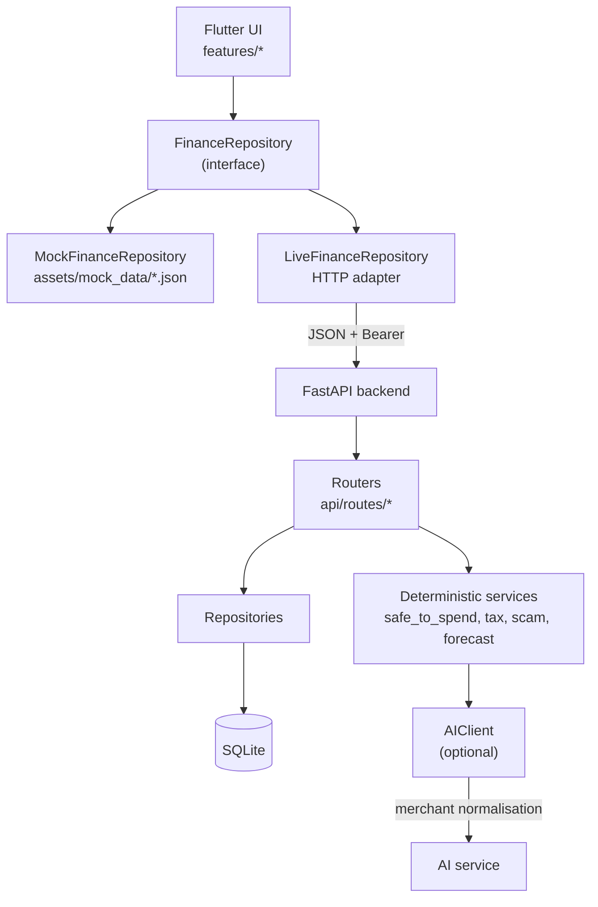
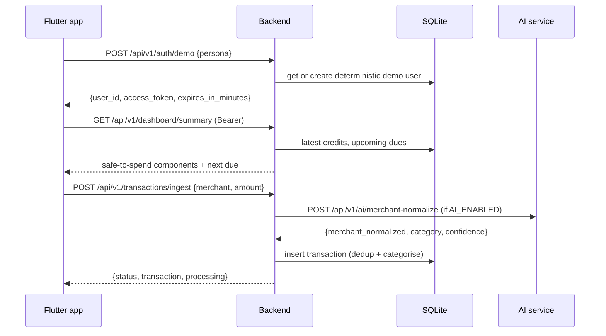

# Architecture

## 1. System shape



## 2. Components

### Flutter app (`mobile/`)

- **Presentation:** `features/` screens (auth, dashboard, transactions, dues, subscriptions, nudges, scam, tax, business, investments, settings).
- **Contract:** every screen depends on `FinanceRepository` only.
- **Implementations:** `MockFinanceRepository` (bundled fixtures) and `LiveFinanceRepository` (HTTP).
- **Adapter boundary:** `LiveFinanceRepository` is the single place that knows backend envelopes (`items`), demo auth, and field-name differences.
- **State:** local `StatefulWidget` state plus Riverpod provisioning for repository access.
- **Navigation:** GoRouter with path-based navigation (`context.go` / `context.push`).

### Backend (`backend/`)

- **Routers** (`api/routes/`) are thin: validate, call a service or repository, return a schema.
- **Services** (`services/`) own all financial logic. They never call the network except `AIClient`.
- **Repositories** (`repositories/`) own queries and are always user-scoped.
- **Models** (`models/`) are SQLAlchemy tables; **schemas** (`schemas/`) are Pydantic contracts.
- **Rules** (`rules/*.json`) hold editable data: merchant aliases, categories, tax slabs.
- **Errors** are normalised in `main.py` into `{"error": {"code", "message", "details"}}`.

### AI service (`ai_service/`)

- Stateless FastAPI service with no database and no access to backend models.
- Deterministic dictionaries handle common merchants; an LLM is used only when configured.
- Output is validated and safety-filtered; failures return deterministic fallbacks.
- **Only merchant normalisation is currently called by the backend.** The scam-explanation and nudge endpoints exist and are tested, but are not wired into backend flows yet.

## 3. Request flow (live mode)



## 4. Money rules

- All amounts are **integer paise** (`₹100 = 10000`).
- No floating-point arithmetic for money; formatting happens only in presentation.
- Dates are `YYYY-MM-DD`; timestamps are ISO-8601 with timezone.
- The backend is authoritative for:
  - safe-to-spend,
  - tax comparison,
  - scam risk score and verdict,
  - subscription/dues detection,
  - cash-flow projection.

## 5. Safe-to-spend

```text
safe_to_spend = max(
  0,
  available_balance
  + confirmed_projected_income
  - upcoming_mandatory_dues_within_horizon
  - safety_reserve
)
```

Defaults: 30-day horizon, 10% safety reserve. The response discloses every component plus `calculation_date`, `calculated_until`, `forecast_horizon_days`, and `data_confidence`.

## 6. Authentication model

- The MVP has **synthetic demo sessions**, not production authentication.
- `POST /api/v1/auth/demo` accepts a persona, creates or reuses a deterministic user, and returns the user UUID as an opaque bearer token.
- Protected endpoints resolve the token to a user and scope every query to that user.
- There are no passwords, no registration, and no token expiry enforcement.
- Flutter's login/register screens start this demo session for the selected persona and state this explicitly in live mode.

Production auth (hashed credentials, refresh tokens, expiry) is a deliberate roadmap item, not an oversight.

## 7. Error handling

- Backend maps HTTP status to a contract code (`VALIDATION_ERROR`, `AUTHENTICATION_REQUIRED`, `NOT_FOUND`, `METHOD_NOT_ALLOWED`, `PAYLOAD_TOO_LARGE`, `AI_SERVICE_UNAVAILABLE`, …).
- Unexpected exceptions return `INTERNAL_ERROR` without leaking internals.
- Flutter's `ApiClient` converts 401 → `UnauthorizedException`, network failures → `NetworkException`, and contract errors → `AppException` with the backend's code.
- Screens render `ErrorState` with a retry action instead of spinning forever.

## 8. AI boundaries

| Allowed | Not allowed |
|---|---|
| Normalise merchant names | Compute money, tax or safe-to-spend |
| Explain a backend-provided risk score | Decide or override a risk score |
| Phrase a backend-approved nudge | Invent numbers or eligibility |
| Be unavailable and fall back silently | Crash the backend |

Privacy: prompts are masked (account numbers, UPI IDs, phone numbers) and capped in length; the service is stateless and logs no request bodies.

## 9. Data and isolation

- SQLite file by default (`backend/dueswise.db`), configurable with `DATABASE_URL`.
- Every repository call takes `user_id`; cross-user reads return 404.
- Tests use an isolated temporary SQLite database.

## 10. Known architectural gaps

- No migrations (Alembic) — schema is created with `create_all`.
- No background scheduler for nudges/due reminders; computation is on request.
- No rate limiting or audit logging beyond request logs.
- Single-process SQLite; not suitable for concurrent production scaling.
